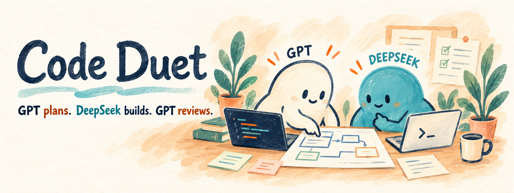
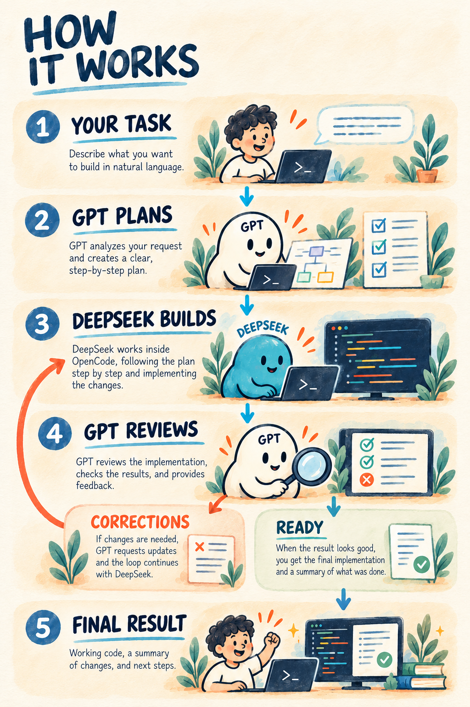
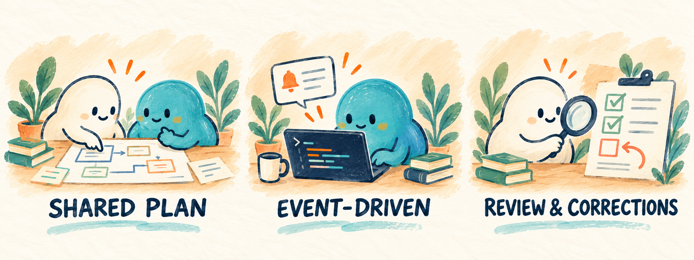

# Code Duet



**English** · Русский and 简体中文 translations coming after the English edition is approved.

**One task. Two roles. A shared plan.**

Code Duet connects **GPT in Codex** with **DeepSeek in OpenCode**. Give GPT a task: it explores your project, prepares a plan, and hands the work to DeepSeek. When DeepSeek finishes, GPT reviews the result and requests corrections if needed. You get a report and stay in control of acceptance.

> **Preview:** Code Duet is under active development. Its coordination and event-observer paths have been tested with simulated executors; full acceptance across real projects is still in progress. Check the limitations below before using it on an important task.

## How it works



1. **You describe the task** to GPT in Codex.
2. **GPT investigates and plans**, then sends an identified assignment to DeepSeek in OpenCode.
3. **DeepSeek implements** while Codex waits for an event.
4. **GPT reviews** the changes and checks the result after the executor has finished.
5. **Corrections or result:** if changes are needed, GPT sends a consolidated correction back to DeepSeek. When the criteria are met, GPT reports the result to you.

The two roles take turns on the same project. A passing check or an executor's final message alone does not establish that the work is correct, and the illustration shows the intended successful path rather than a guarantee.

## What you get



- **One shared plan.** Keep the task, progress, and review checkpoints in the project.
- **A clear division of work.** Codex plans and reviews; DeepSeek implements in OpenCode.
- **Fewer manual handoffs.** Send a bounded assignment through the helper and receive questions, completion, or errors in the same Codex chat.
- **Event-driven waiting.** After the observer is armed, Codex can finish its turn and continue when a meaningful event arrives.

### Less copying between chats

Without a coordinator, you may need to copy the assignment to an executor, wait for a reply, and bring the result back for review. Code Duet coordinates those handoffs around the shared plan; you can focus on the task and the final review.

## Requirements

- Windows with the Codex desktop app and OpenCode Desktop.
- Node.js 24.
- OpenCode engine version **2.1.4 or 2.2.0**, with access to `opencode-go/deepseek-v4.1-flash`. Code Duet does not automatically switch models.
- A project directory and a plan that Codex and OpenCode can both access.

## Install

Clone this repository, then package the skill into a **new** user skill directory. The packager refuses to overwrite an existing `code-duet` folder.

```powershell
git clone https://github.com/yarinka-yyy/codeduet.git
Set-Location codeduet
node .\tools\package.mjs "$env:USERPROFILE\.codex\skills\code-duet"
```

The parent `C:\Users\<you>\.codex\skills` must exist. If Code Duet is already installed, preserve and review the existing installation before replacing it. See [runtime and packaging](references/runtime.md) for the helper check and package details.

## Start a task

In a Codex chat opened in your project, invoke the skill and describe the work:

```text
$code-duet
Help me implement this task in the current project. Investigate it, prepare the plan, and coordinate implementation with DeepSeek in OpenCode.
```

Codex checks the workspace and plan, prepares a bounded assignment, and uses the existing OpenCode connection. Once an observer reports that it is armed, Codex ends its turn and resumes on an event. The user starts a new Codex chat manually when needed; a new chat does not reset a plan's correction count.

You can also select an existing OpenCode session. Adoption requires the existing work to have safely ended.

## Limits and safety

- Up to **20 correction cycles** per plan after the initial assignment. The counter follows the plan across continuations.
- An uncertain delivery stops the workflow; it is not automatically retried. An unknown owner or retained lock requires diagnosis, not a manual unlock.
- The observer depends on the desktop app and its supported queue command. A closed app, shutdown, or changed CLI can prevent notification; inspect the existing receipt after an interruption.
- Human review remains necessary. Simulation and passing tests do not replace acceptance in the real target project.

For commands and troubleshooting, see the [helper protocol](helper/PROTOCOL.md), [event observer](helper/OBSERVER.md), and [workflow](references/workflow.md).
