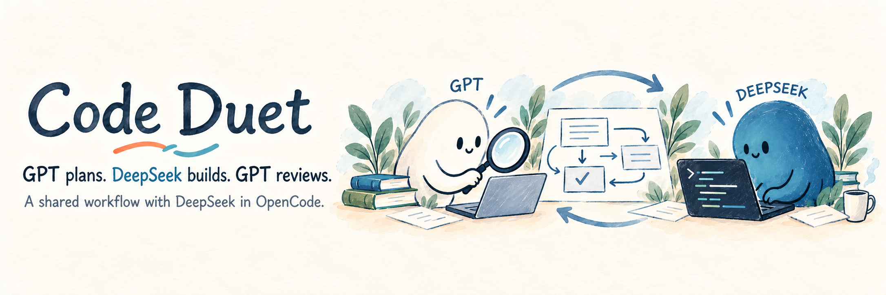
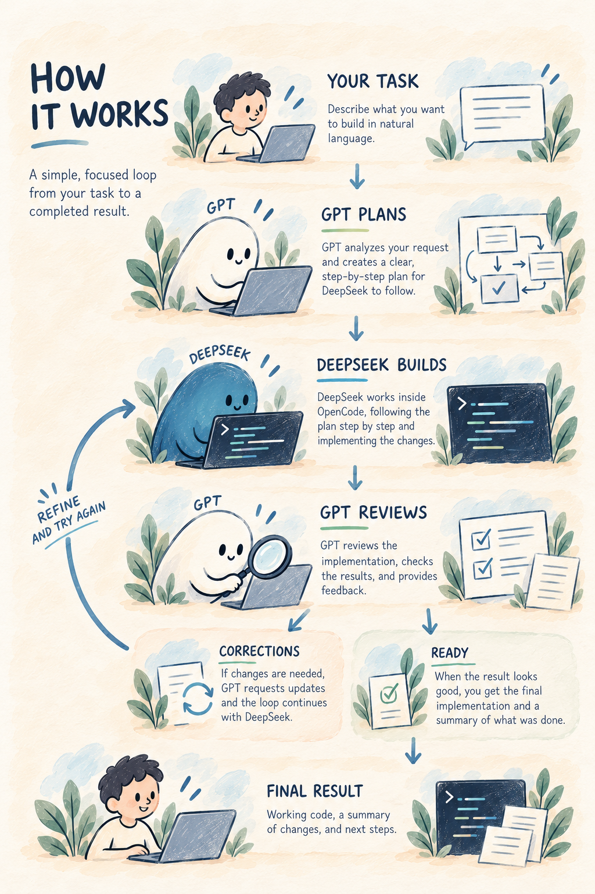

Code Duet is a Codex skill that turns **GPT in Codex** and **DeepSeek in OpenCode** into a coordinated development workflow. Describe what you want to build: GPT studies your project and prepares the plan, DeepSeek writes the code, and GPT checks the result and guides the corrections.

You follow the work in your Codex chat, with a shared plan in your project and a final report of the changes and checks. Code Duet handles the handoffs between the two tools.

## How it works



<details>
<summary>The workflow in words</summary>

1. **You describe the task.** GPT explores the project and turns your request into a plan with clear scope and completion criteria.
2. **DeepSeek implements.** GPT sends the assignment to OpenCode. DeepSeek edits the project and runs the planned checks.
3. **GPT reviews.** After DeepSeek finishes, GPT inspects the actual changes and checks them against the plan.
4. **Corrections or completion.** GPT sends a consolidated correction if more work is needed. When the criteria are met, it reports the result, the checks, and any remaining work.

</details>

## What Code Duet handles for you

| | How it helps |
|---|---|
| **One shared plan** | Keep the task, scope, progress, and review checkpoints together in your project. Create a plan or continue an existing one, including plans from Improve Codex. |
| **Direct handoffs** | Assignments, executor questions, and results travel between Codex and OpenCode without copying messages between chats. |
| **Quiet waiting** | A background observer watches for a question, completion, or error. GPT ends its turn while DeepSeek works and continues in the same chat when attention is needed. |
| **Separate review** | DeepSeek implements; GPT reviews the files and checks the result. They take turns working on the project. |
| **Continued context** | Saved session bindings, assignment IDs, and plan checkpoints keep later work connected to the right task. |

The local helper communicates with OpenCode's running engine. Normal coordination leaves your mouse and keyboard free.

## Quick start

### 1. Prepare your tools

Use Windows with the **Codex desktop app**, **OpenCode Desktop**, and **Node.js 24**. OpenCode needs access to **DeepSeek V4.1 Flash through OpenCode Go**. Open your project in Codex and start OpenCode Desktop.

Supported OpenCode engine versions: **2.1.4** and **2.2.0**. The helper uses Node's built-in modules; no npm dependencies are required.

### 2. Install the skill

Run in PowerShell:

```powershell
git clone https://github.com/yarinka-yyy/codeduet.git
Set-Location codeduet
New-Item -ItemType Directory -Force "$env:USERPROFILE\.codex\skills" | Out-Null
node .\tools\package.mjs "$env:USERPROFILE\.codex\skills\code-duet"
```

The destination must be a new `code-duet` folder. For an existing installation or a project-local setup, see [installation and runtime](references/runtime.md).

### 3. Give GPT a task

In your project's Codex chat:

```text
$code-duet
Add a CSV export to the reports page. Study the project, prepare a plan,
and coordinate implementation and review with DeepSeek in OpenCode.
```

You can also ask Code Duet to work from an existing plan. It reuses the chat's saved OpenCode pairing or creates a session for the project. To use a particular existing OpenCode session, select it explicitly; see [existing sessions](references/existing-session.md).

## Through questions and corrections

When DeepSeek asks a question, GPT answers within the task's scope and your permissions. Decisions that need your input come back to you. After implementation, GPT checks the work and sends corrections as a single assignment.

Each plan allows up to **20 correction cycles** after the initial implementation. The count follows the plan across continuations. The final report explains what changed, what was checked, and what remains to be done.

## Documentation

- [Workflow and shared plans](references/workflow.md)
- [Installation and local runtime](references/runtime.md)
- [Selecting an existing OpenCode session](references/existing-session.md)
- [Event observation and interrupted runs](helper/OBSERVER.md)
- [Helper commands and diagnostics](helper/PROTOCOL.md)
