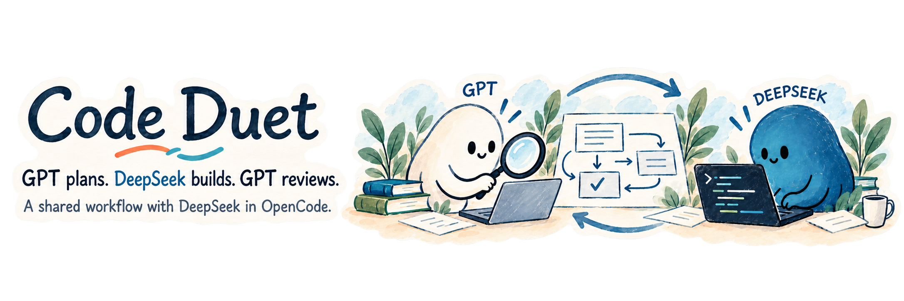
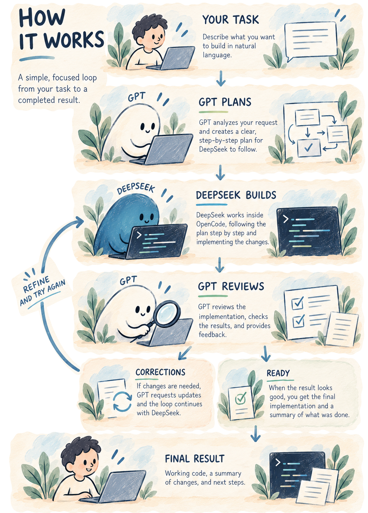

**English** · [Русский](README.ru.md) · [简体中文](README.zh-CN.md)

Code Duet is a Codex skill where **GPT plans and reviews, and DeepSeek writes the code in OpenCode**. Describe your task: GPT studies the project, prepares a plan, and hands it to DeepSeek. Once the code is ready, GPT reviews the changes, runs checks, and sends back anything that needs fixing. It reviews the corrections and lets you know when the task is complete.

Code Duet brings the two AIs together: GPT handles planning, difficult decisions, and review; DeepSeek handles implementation. The skill passes assignments, questions, and results between them. You give the task in your Codex chat and receive the finished work with a report of what changed and how it was checked.

## How it works

<p align="center">
  
</p>

<details>
<summary>The workflow in words</summary>

1. **You describe the task.** Tell GPT what you want to build. It explores the project and writes a plan covering the changes and how to check the result.
2. **DeepSeek writes the code.** GPT sends the assignment to OpenCode. DeepSeek follows the plan and runs the necessary checks.
3. **GPT reviews the work.** When DeepSeek finishes, GPT inspects the changed files, checks the result, and compares it with your request.
4. **Corrections, if needed.** GPT sends concrete feedback to DeepSeek, waits for the fixes, and reviews the work again.
5. **You get the result.** Once the work passes review, GPT tells you it is ready and explains what changed and how it was checked.

</details>

## What Code Duet handles for you

| | How it helps |
|---|---|
| **From task to plan** | GPT turns your request into a clear Markdown plan: what to do, in what order, and what a finished result should look like. DeepSeek follows it; GPT reviews against it. |
| **Automatic handoffs** | The skill passes assignments, questions, results, and feedback between GPT and DeepSeek. You set the task; they work through implementation and review. |
| **GPT returns when needed** | After handing over the task, GPT waits while DeepSeek works. A background observer brings GPT back to the same chat when the work is finished, an error occurs, or a question needs an answer. |
| **Review and corrections** | GPT inspects the actual changes and runs checks. When it finds problems, it sends them to DeepSeek and reviews the fixes before accepting the result. |
| **Continue in the same chats** | GPT and DeepSeek keep working on your project in their respective chats, staying with the current task and the changes already made. |

Coordination runs in the background without taking over your mouse or keyboard. You can keep using your computer while the AIs work on the task.

## Quick start

### 1. Prepare your tools

Use Windows with the **Codex desktop app**, **OpenCode Desktop**, and **Node.js 24**. OpenCode needs access to **DeepSeek V4.1 Flash through OpenCode Go**. Open your project in Codex and start OpenCode Desktop.

Supported OpenCode engine versions: **2.1.4**, **2.2.0**, **2.2.1**, **2.2.2**, **2.2.3**, and **2.2.5**. The helper uses Node's built-in modules; no npm dependencies are required.

### 2. Install the skill

Run in PowerShell:

```powershell
git clone https://github.com/yarinka-yyy/codeduet.git
Set-Location codeduet
New-Item -ItemType Directory -Force "$env:USERPROFILE\.codex\skills" | Out-Null
node .\tools\package.mjs "$env:USERPROFILE\.codex\skills\code-duet"
```

The destination must be a new `code-duet` folder. For an existing installation or a project-local setup, see [installation and runtime](references/runtime.md).

### 3. Give GPT a task

Tell GPT what you want to build in your Codex chat:

```text
$code-duet
Add a CSV export to the reports page.
```

GPT will explore the project, prepare a plan, and hand the work to DeepSeek. Code Duet connects an OpenCode chat for your project and keeps the work there. If DeepSeek is already working in the chat you want to follow, name it — for example, “watch DeepSeek's work in chat P5.”

## Through questions and corrections

When DeepSeek has a question about implementation, GPT helps it move forward. It comes back to you when your decision or permission is needed. After review, GPT collects its feedback into one assignment so DeepSeek can address it in the next pass.

Each plan allows up to **20 correction cycles** after the initial implementation. If an error blocks the work, your input is needed, or the limit is reached, GPT explains what is preventing completion. When the task is ready, you receive a final report of the changes and checks.

## Documentation

- [Workflow and shared plans](references/workflow.md)
- [Installation and local runtime](references/runtime.md)
- [Working with an existing OpenCode chat](references/existing-session.md)
- [Event observation and interrupted runs](helper/OBSERVER.md)
- [Helper commands and diagnostics](helper/PROTOCOL.md)
