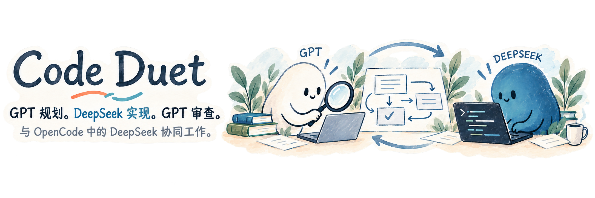
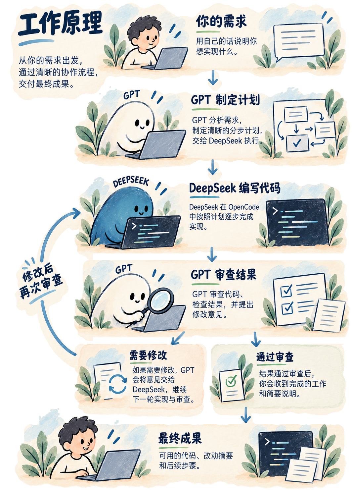

[English](README.md) · [Русский](README.ru.md) · **简体中文**

Code Duet 是一款 Codex 技能（Skill），让 **GPT 负责规划和代码审查，DeepSeek 在 OpenCode 中编写代码**。你只需说明需求，GPT 就会分析项目、制定计划，再将任务交给 DeepSeek。实现完成后，GPT 会审查改动、运行检查，并将需要修改的地方反馈给 DeepSeek。修改完成后，GPT 会再次检查，确认任务完成后再向你汇报。

Code Duet 将两个 AI 的工作衔接起来：GPT 负责规划、关键决策和结果审查，DeepSeek 负责具体实现。任务、问题、结果和修改意见都由技能自动传递。你在 Codex 对话中提出需求，最终收到完成的工作，以及一份说明具体改动和检查结果的报告。

## 工作原理

<p align="center">
  
</p>

<details>
<summary>查看完整工作流程</summary>

1. **你提出需求。** 告诉 GPT 你想做什么。它会分析项目，并制定计划，明确需要哪些改动、如何检查结果。
2. **DeepSeek 编写代码。** GPT 将任务发送到 OpenCode，DeepSeek 按照计划完成实现，并运行必要的检查。
3. **GPT 审查结果。** DeepSeek 完成后，GPT 会查看实际改动、检查结果，并确认是否满足你的需求。
4. **按需修改。** 如果发现问题，GPT 会向 DeepSeek 提出具体修改意见，等待修改完成后再次审查。
5. **你收到结果。** 工作通过审查后，GPT 会告知你任务已完成，并说明改了什么、做了哪些检查。

</details>

## Code Duet 能帮你做什么

| | 具体作用 |
|---|---|
| **把需求变成计划** | GPT 将你的需求整理成清晰的 Markdown 计划，明确要做什么、按什么顺序做，以及达到什么标准才算完成。DeepSeek 按计划实现，GPT 依据计划审查。 |
| **自动衔接工作** | 技能在 GPT 和 DeepSeek 之间传递任务、问题、结果和修改意见。你提出需求后，它们会依次完成实现与审查。 |
| **需要时唤回 GPT** | 任务交给 DeepSeek 后，GPT 会等待。后台监控程序会在任务完成、出现错误或有问题需要回答时，唤回同一对话中的 GPT。 |
| **审查与修改** | GPT 查看实际改动并运行检查。发现问题后，它会交给 DeepSeek 修改，检查修改结果后再决定是否接受。 |
| **在原有对话中继续** | GPT 和 DeepSeek 各自在自己的对话中继续处理同一个项目，保留当前任务和已有改动的上下文。 |

协调过程在后台运行，不会接管鼠标或键盘。AI 处理任务时，你可以继续使用电脑。

## 快速开始

### 1. 准备工具

你需要在 Windows 上安装 **Codex 桌面应用**、**OpenCode Desktop** 和 **Node.js 24**。OpenCode 需要能够通过 **OpenCode Go 使用 DeepSeek V4.1 Flash**。在 Codex 中打开项目，并启动 OpenCode Desktop。

支持的 OpenCode 引擎版本为 **2.1.4**、**2.2.0**、**2.2.1**、**2.2.2**、**2.2.3** 和 **2.2.5**。辅助程序仅使用 Node.js 内置模块，无需安装 npm 依赖。

### 2. 安装插件

在 PowerShell 中运行：

```powershell
codex plugin marketplace add yarinka-yyy/codeduet
codex plugin add code-duet@code-duet
```

开启新的 Codex 对话并选择 `code-duet:code-duet` 技能。已有的独立技能安装会保留；请参阅[安装与本地运行说明](references/runtime.md)。

### 3. 向 GPT 提出任务

在 Codex 对话中说明你想做什么：

```text
$code-duet:code-duet
为报表页面添加 CSV 导出功能。
```

接下来，GPT 会分析项目、制定计划，并将任务交给 DeepSeek。Code Duet 会为你的项目关联一个 OpenCode 对话，后续工作也会在该对话中继续。如果 DeepSeek 已经在某个对话中处理任务，请明确指出对话名称，例如：“跟踪 P5 对话中 DeepSeek 的工作进展。”

## 问题处理与后续修改

DeepSeek 对实现有疑问时，GPT 会协助它继续工作。需要你作出决定或给予许可时，GPT 会向你询问。审查结束后，GPT 会将修改意见汇总成一个任务，交给 DeepSeek 在下一轮集中处理。

每个计划在首次实现后，最多允许进行 **20 轮修改**。如果错误导致工作无法继续、需要你的意见，或修改轮数已达上限，GPT 会说明阻碍任务完成的原因。任务完成后，你会收到一份汇总改动和检查结果的报告。

## 文档

- [工作流程与共享计划](references/workflow.md)
- [安装与本地运行](references/runtime.md)
- [使用已有的 OpenCode 对话](references/existing-session.md)
- [事件监听与中断后的处理](helper/OBSERVER.md)
- [辅助程序命令与诊断](helper/PROTOCOL.md)
